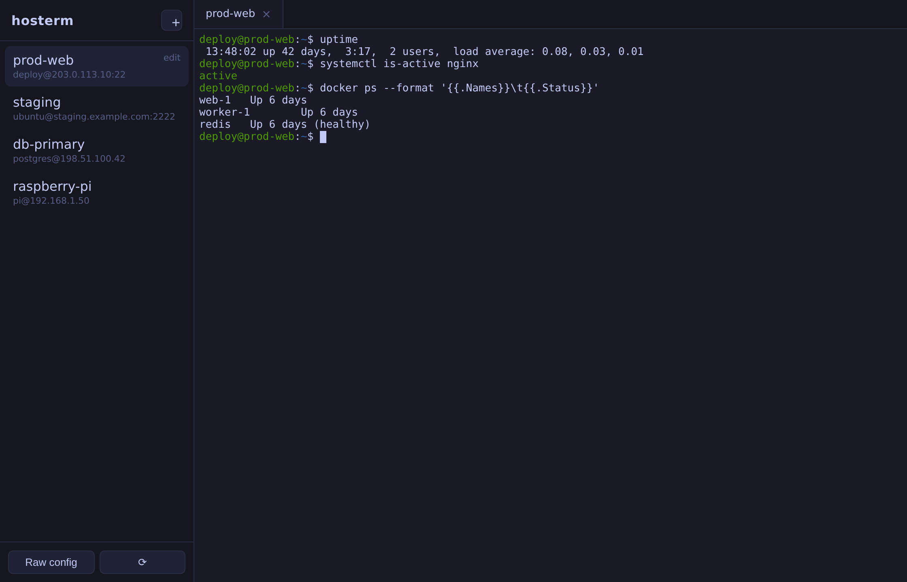

<a name="readme-top"></a>

<div align="center">

# hosterm

A lightweight desktop SSH client whose **single source of truth is `~/.ssh/config`** —
no vault, no proprietary store.

[Features](#features) · [Getting Started](#getting-started) · [Usage](#usage) · [Docs](#docs)


</div>

## Table of Contents

<details>
<summary>Click to expand</summary>

- [About The Project](#about-the-project)
- [Built With](#built-with)
- [Features](#features)
- [Getting Started](#getting-started)
  - [Install (Windows)](#install-windows)
  - [Develop](#develop)
  - [Build](#build)
- [Usage](#usage)
- [Roadmap](#roadmap)
- [Docs](#docs)
- [License](#license)

</details>

## About The Project

hosterm is a Termius-style desktop SSH client built on a simple principle: your
`~/.ssh/config` stays the one file that matters. hosterm reads it, lists your hosts,
and writes edits straight back — it never introduces a database or a proprietary store.
Switch devices by copying one file.

It spawns the real OS `ssh` binary in an embedded terminal, so everything your
`~/.ssh/config` already expresses is honored exactly as the command line would honor
it: `ProxyJump`, `IdentityFile`, forwarding, `Match` blocks, and the rest.




> Screenshots use sample hosts; the app reads your real `~/.ssh/config`.

<p align="right">(<a href="#readme-top">back to top</a>)</p>

## Built With

- [Tauri v2](https://v2.tauri.app/) — Rust backend + web UI
- [Rust](https://www.rust-lang.org/)
- [TypeScript](https://www.typescriptlang.org/)
- [xterm.js](https://xtermjs.org/) — embedded terminal
- [CodeMirror](https://codemirror.net/) — remote editor

<p align="right">(<a href="#readme-top">back to top</a>)</p>

## Features

- Sidebar listing every `Host` entry from `~/.ssh/config`
- Embedded terminal tabs (xterm.js) — multiple connections, split view, per-tab status
- **SFTP file browser** per host: browse remote directories, upload and download files —
  powered by the real `sftp` binary, so it honors your ssh config too
- **Remote text editor**: click any file in the SFTP browser to edit it in place
  (CodeMirror, line numbers, Ctrl/Cmd+S to save back) — no more nano/vim over ssh
- Add / edit / delete hosts via a form — **round-trip safe**: comments, ordering, and
  unknown directives in your config are preserved
- Auth per host: **key** (pick an `IdentityFile`) or **password** (ssh prompts you on
  connect; with your opt-in the password is stored once in a `0600` sidecar file and
  never leaves your machine)
- **Paste a private key** to create an identity — hosterm writes it to `~/.ssh/<name>`
  at `0600` and it appears in the key dropdown
- "Raw config" editor to hand-edit `~/.ssh/config` directly inside the app
- Config written **atomically** (temp + rename), never overwritten with empty if the
  existing file can't be read; `0600` permissions on Unix
- **No telemetry** — no network calls except the SSH connections you start

<p align="right">(<a href="#readme-top">back to top</a>)</p>

## Getting Started

### Install (Windows)

Download the `hosterm` installer (`.exe` / `.msi`) from the
[Releases](https://github.com/MEKL20/hosterm/releases) page and run it. Requires the
**Microsoft Edge WebView2 Runtime**, preinstalled on current Windows 10/11; on older
installs, get it free from Microsoft.

> Note: Windows releases are currently **unsigned**, so SmartScreen may show an
> "unknown publisher" prompt.

### Develop

Linux/macOS/Windows:

```bash
npm install
npm run tauri dev
```

Linux build deps (Debian/Ubuntu): `libwebkit2gtk-4.1-dev build-essential pkg-config
librsvg2-dev libssl-dev libxdo-dev libayatana-appindicator3-dev`.

### Build

```bash
npm run tauri build
```

<p align="right">(<a href="#readme-top">back to top</a>)</p>

## Usage

1. Open hosterm — it lists every `Host` entry from your `~/.ssh/config` in the sidebar.
2. Click a host to open a terminal tab; the real `ssh` binary connects using your
   config (keys, ProxyJump, forwarding — all as configured).
3. Open the ⇅ tab on a host to browse its files over SFTP; click a text file to edit
   it in place and save back with Ctrl/Cmd+S.
4. Add or edit a host from the sidebar — changes are written back to `~/.ssh/config`
   atomically, preserving everything hosterm doesn't touch.

Override the config path for testing with the `HOSTERM_CONFIG` env var.

<p align="right">(<a href="#readme-top">back to top</a>)</p>

## Roadmap

- [x] UX redesign "Arus" + Abyss Emerald theme (shipped in v0.11.0)
- [x] Fleet Run v1 — backend command engine
- [ ] Fleet Run v1 — panel UI, live output, summary
- [ ] Windows code signing (SignPath — postponed; releases are unsigned for now)
- [ ] Verified auto-updater (after signing)
- [ ] Config auto-reload on window focus
- [ ] SFTP for password-auth hosts (persistent session)

See [docs/STATE.md](docs/STATE.md) for detailed status, risks, and waivers.

<p align="right">(<a href="#readme-top">back to top</a>)</p>

## Docs

Full documentation lives in [`docs/`](docs/README.md):

- [PRD.md](docs/PRD.md) — product requirements
- [SDD.md](docs/SDD.md) — architecture & design
- [TSD.md](docs/TSD.md) — technical/delivery spec
- [STATE.md](docs/STATE.md) — living status, risks & waivers

Release history: [CHANGELOG.md](CHANGELOG.md).

<p align="right">(<a href="#readme-top">back to top</a>)</p>

## License

Distributed under the MIT License. See [`LICENSE`](LICENSE) for more information.

<p align="right">(<a href="#readme-top">back to top</a>)</p>
