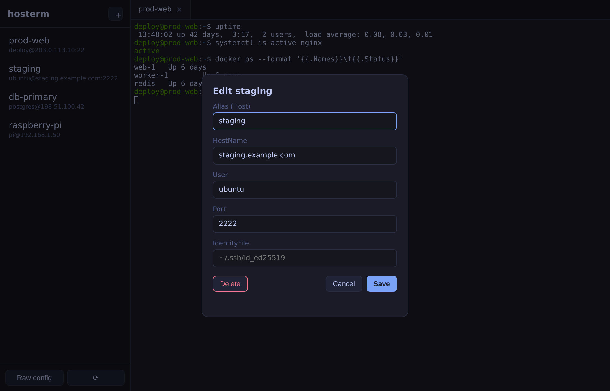

# Hosterm

A lightweight desktop SSH client (Termius-style) whose **single source of truth is
`~/.ssh/config`** — no vault, no proprietary store. Switch devices by copying one file.

Built with Tauri v2 (Rust backend + web UI). Spawns the real OS `ssh` binary in an
embedded terminal, so everything in your `~/.ssh/config` is honored exactly as the
command line would honor it (ProxyJump, IdentityFile, forwarding, Match blocks, etc.).




> Screenshots use sample hosts; the app reads your real `~/.ssh/config`.

## Features

- Sidebar listing every `Host` entry from `~/.ssh/config`
- Click a host to open an embedded terminal tab (xterm.js); multiple tabs at once
- **SFTP file browser** per host (⇅ tab): browse remote directories, upload and
  download files — powered by the real `sftp` binary, so it honors your ssh
  config (ProxyJump, IdentityFile, …). Requires key/agent auth; password-auth
  hosts still work in the terminal tab (persistent-session SFTP is planned).
- **Remote text editor** (✎ tab): click any file in the SFTP browser to edit it
  in place (CodeMirror, line numbers, Ctrl/Cmd+S to save back) — no more
  nano/vim over ssh. Text files up to 2 MB; binary files are refused.
- Add / edit / delete hosts via a form — writes straight back to `~/.ssh/config`,
  **preserving comments, ordering, and unknown directives** (round-trip safe)
- Choose auth per host: **key** (pick an `IdentityFile` from a dropdown) or
  **password** (ssh prompts you on connect — with your opt-in, the password is stored once in a 0600 sidecar file next to your config and auto-typed on connect; nothing leaves your machine)
- **Create an identity key by pasting the private key text** — hosterm writes it
  to `~/.ssh/<name>` at `0600`, then it appears in the key dropdown (Termius-style)
- "Raw config" editor to hand-edit the file directly inside the app
- Config written atomically (temp + rename) and never overwritten with empty if
  an existing file can't be read; files get `0600` permissions on Unix
- No telemetry, no network calls except the SSH connections you start

## Authentication

OpenSSH's config format has no `Password` directive — passwords live only in a
client's vault, which hosterm deliberately avoids (the whole point is a portable
plain-text config). So:

- **Key auth** writes `IdentityFile`. Pick an existing key from the dropdown, or
  paste a new private key and hosterm saves it as a `0600` file beside the config.
- **Password auth** writes `PreferredAuthentications password` +
  `PubkeyAuthentication no`, and ssh prompts for the password in the embedded
  terminal at connect time. Nothing secret is stored, so copying your
  `~/.ssh/config` to another device stays safe and complete.

## How it stores config

There is no database. The app reads and writes `~/.ssh/config` directly using a
parser that keeps every line it does not understand verbatim. Pattern blocks
(`Host *`, wildcards) are shown read-only in the sidebar and never rewritten by the form.

Override the path for testing with the `HOSTERM_CONFIG` env var.

## Install (Windows)

Download `hosterm.exe` from the [Releases](https://github.com/MEKL20/hosterm/releases)
page and run it. Requires the **Microsoft Edge WebView2 Runtime**, which is preinstalled
on current Windows 10/11; on older installs, install it from Microsoft (free).

## Develop (Linux/macOS/Windows)

```bash
npm install
npm run tauri dev
```

Linux build deps (Debian/Ubuntu): `libwebkit2gtk-4.1-dev build-essential pkg-config
librsvg2-dev libssl-dev libxdo-dev libayatana-appindicator3-dev`.

## Build

```bash
npm install
npm run tauri build
```

The Windows installers (NSIS `.exe` / WiX `.msi`) are built on a `windows-latest`
runner by [`.github/workflows/build-windows.yml`](.github/workflows/build-windows.yml)
— push a `v*` tag (or trigger it manually) and the assets are attached to the
GitHub release. Cross-building the raw `.exe` from Linux is not part of the
release flow (the recipe used to live in `BUILD-WINDOWS-FROM-LINUX.md`, now
removed; the knowledge is preserved in the maintainer's `tauri-cross-build-windows`
skill).

## Code signing policy

Windows releases of hosterm are Authenticode-signed so Windows can confirm they
come from this project and have not been altered since. Only the artifacts this
project builds from its own source are signed: `hosterm.exe` and the NSIS/WiX
installers that carry it.

Free code signing provided by [SignPath.io](https://about.signpath.io),
certificate by [SignPath Foundation](https://signpath.org).

Nothing is signed by hand. Pushing a `v*` tag runs
[`.github/workflows/build-windows.yml`](.github/workflows/build-windows.yml) on
GitHub's own `windows-latest` runners, which builds hosterm from the source at
that tag, submits the artifacts to SignPath via the official
`signpath/github-action-submit-signing-request`, and attaches the signed
artifacts to the GitHub release. A build from any other branch or workflow is
not signed, and each release's signing request requires one manual approval in
the SignPath dashboard.

### Project roles

hosterm is maintained by a single developer who holds all roles:

- Committers and reviewers: [MEKL20](https://github.com/MEKL20)
- Approvers: [MEKL20](https://github.com/MEKL20)

### Privacy policy

This program will not transfer any information to other networked systems unless
specifically requested by the user or the person installing or operating it.
hosterm only connects to the SSH/SFTP hosts its user starts a session to, and
has no telemetry, analytics, or automatic update checks. The one exception is
the user-initiated "Check for updates" action (planned), which fetches release
metadata from GitHub Releases only when the user clicks it.

## License

MIT — see [LICENSE](LICENSE).
